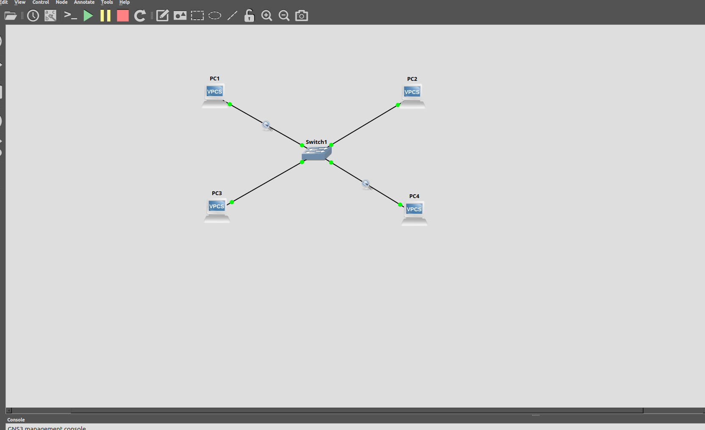
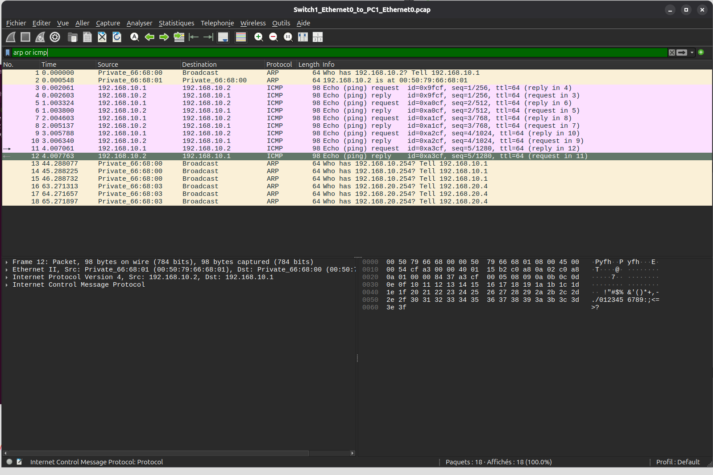

# Lab 01 – Réseau local commuté et analyse ARP/ICMP

- **Environnement :** GNS3 2.2 · Ubuntu · VPCS · Ethernet switch intégré · Wireshark
- **Statut :** terminé

---

## Objectif

Mettre en place un réseau local composé de quatre postes et d'un switch, valider la connectivité
entre les hôtes, puis analyser avec Wireshark les échanges qui ont lieu lors d'un ping
(résolution ARP et messages ICMP).

Ce lab sert aussi à démontrer qu'un switch seul ne permet pas la communication entre deux
sous-réseaux IP distincts.

---

## Topologie



| Équipement | Type            | Rôle           |
|------------|-----------------|----------------|
| Switch1    | Ethernet switch | Switch d'accès |
| PC1 à PC4  | VPCS            | Postes clients |

---

## Plan d'adressage

| Poste | Adresse IP   | Masque | Passerelle     | Port du switch |
|-------|--------------|--------|----------------|----------------|
| PC1   | 192.168.10.1 | /24    | 192.168.10.254 | Ethernet0      |
| PC2   | 192.168.10.2 | /24    | 192.168.10.254 | Ethernet1      |
| PC3   | 192.168.10.3 | /24    | 192.168.10.254 | Ethernet2      |
| PC4   | 192.168.20.4 | /24    | 192.168.20.254 | Ethernet3      |

PC4 est volontairement placé dans un sous-réseau différent afin de vérifier le comportement
du réseau en l'absence de routeur (voir test n°3).

---

## Configuration

Les configurations complètes des postes sont disponibles dans le dossier [`configs/`](configs/).

Exemple de configuration (PC1) :

```
PC1> ip 192.168.10.1/24 192.168.10.254
PC1> save
```

---

## Tests et résultats

| N° | Test                     | Résultat attendu | Résultat obtenu |
|----|--------------------------|------------------|-----------------|
| 1  | Ping PC1 → PC2           | Succès           | Succès          |
| 2  | Ping PC1 → PC3           | Succès           | Succès          |
| 3  | Ping PC1 → PC4           | Échec            | Échec (attendu) |

---

## Analyse Wireshark

Captures disponibles dans le dossier [`captures/`](captures/) :

- `Switch1_Ethernet0_to_PC1_Ethernet0.pcap` : lien PC1 ↔ Switch1 (tests 1 et 2)
- `PC4_Ethernet0_to_Switch1_Ethernet3.pcap` : lien PC4 ↔ Switch1 (test 3)

**Ping entre hôtes du même sous-réseau (PC1 → PC2) :**

1. **ARP Request** envoyée en broadcast (`ff:ff:ff:ff:ff:ff`) : PC1 demande l'adresse MAC
   associée à 192.168.10.2.
2. **ARP Reply** envoyée en unicast : PC2 répond avec son adresse MAC.
3. **ICMP Echo Request / Echo Reply** : échange du ping proprement dit.



**Ping vers un autre sous-réseau (PC1 → PC4) :**

La destination n'appartenant pas à son réseau, PC1 cherche à joindre sa passerelle
(192.168.10.254) et émet des requêtes ARP pour la résoudre. Aucun équipement ne porte cette
adresse : les requêtes restent sans réponse et le ping échoue.

---

## Enseignements

- Le premier ping peut être plus lent que les suivants, car il déclenche la résolution ARP ;
  l'adresse MAC est ensuite conservée en cache.
- Un switch opère au niveau 2 : il ne permet pas à deux sous-réseaux IP différents de
  communiquer. Un équipement de niveau 3 (routeur) est nécessaire, ce qui fera l'objet du Lab 02.
- Ce premier lab m'a permis de consolider les fondamentaux du réseau (adressage IP, rôle du
  switch, fonctionnement d'ARP et d'ICMP) et de mettre en place une méthode de documentation
  réutilisable pour les labs suivants.
