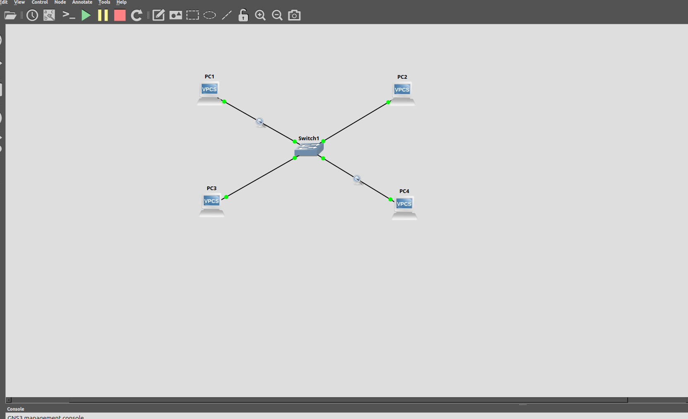
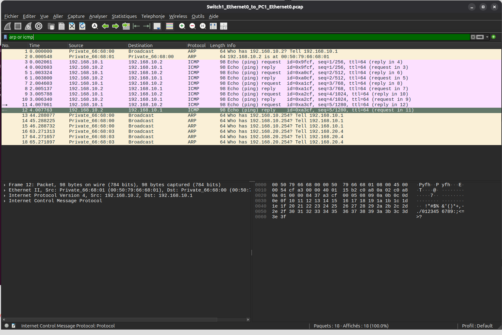

# Lab 01 — Réseau LAN simple et analyse ARP/ICMP

 

## 🎯 Objectif

Mettre en place un réseau local avec 4 postes et un switch, vérifier la connectivité,
puis analyser avec Wireshark ce qui se passe réellement lors d'un ping (ARP + ICMP).

## 🗺️ Topologie



| Équipement | Type             | Rôle             |
|------------|------------------|------------------|
| SW1        | Ethernet switch  | Switch d'accès   |
| PC1 → PC4  | VPCS             | Postes clients   |

## 📋 Plan d'adressage

| Poste | Adresse IP       | Masque | Passerelle      | Port switch |
|-------|------------------|--------|-----------------|-------------|
| PC1   | 192.168.10.1     | /24    | 192.168.10.254  | e0          |
| PC2   | 192.168.10.2     | /24    | 192.168.10.254  | e1          |
| PC3   | 192.168.10.3     | /24    | 192.168.10.254  | e2          |
| PC4   | 192.168.20.4     | /24    | 192.168.20.254  | e3          |

> PC4 est volontairement dans un autre sous-réseau (voir test n°3).

## ⚙️ Configuration

Configurations complètes dans [`configs/`](configs/).

```
PC1> ip 192.168.10.1/24 192.168.10.254
PC1> save
```

## ✅ Tests et résultats

| # | Test                     | Résultat attendu | Résultat obtenu |
|---|--------------------------|------------------|-----------------|
| 1 | Ping PC1 → PC2           | Succès           | ✅              |
| 2 | Ping PC1 → PC3           | Succès           | ✅              |
| 3 | Ping PC1 → PC4           | Échec            | ❌ (normal)     |

## 🔍 Analyse Wireshark

Capture : [`captures/ping-pc1-pc2.pcapng`](captures/)

1. **ARP Request** (broadcast `ff:ff:ff:ff:ff:ff`) : PC1 demande « qui a 192.168.10.2 ? »
2. **ARP Reply** (unicast) : PC2 répond avec son adresse MAC
3. **ICMP Echo Request / Reply** : le ping proprement dit



## 💡 Ce que j'ai appris

-Pourquoi le premier ping est parfois plus lent (résolution ARP)
-Un switch ne fait pas communiquer deux sous-réseaux différents : il faut un routeur
-Le but était de reprendre les bases du réseau et de comprendre petit à petit  


